# Odum conventions checklist

**Status: approved, all items** (2026-10-30). This is the list of drawing
conventions the package implements, each taken from Odum's own figures in
`reference-images/`. Every item has a small test drawing beside its evidence
crop, and the examples and user guide are judged against this list, not against
impressions.

Decisions taken where the references leave room for choice:

| Item | Decision |
|---|---|
| C03 | An edge key draws heat taken off the pathway; the branch joins the ground bundle like any tributary. |
| C06 | Automatic: an interaction attached to a consumer is drawn as the consumer's notch. |
| C07 | Automatic layout places sources around the frame by transformity. |
| C08 | A new `feedback` pathway type: exempt from the falling-quality check, arcs over into the receiver's top. |
| C14 | A new `misc` type is Odum's miscellaneous box and dissipates; `box` stays a plain annotation frame. |
| C21 | Worked examples are traced from their reference figures. |

Status key, against `main` plus the unfinished commit `be1a514`:
**OK** already correct · **WIP** done in `be1a514`, not yet reviewed ·
**Partial** · **Wrong** the package contradicts the reference ·
**Missing** not implemented.

---

## A. Line work

### C01 — Three line weights
Pathways between components, heat-sink pathways and the system frame are drawn at
three different weights. Summed ink across each stroke (144 DPI, good to about
±0.3 px):

| Stroke | modern-civilisation | pyramids | Ratio to a pathway |
|---|---|---|---|
| Pathway | 2.4–2.6 px | — | 1 |
| Symbol outline | 2.4 px | — | ≈ 1 |
| Heat-sink pathway | 1.2–1.6 px | 1.0–1.6 px | ≈ 0.5 |
| System frame | 3.6 px | 4.3 px | ≈ 1.5 |

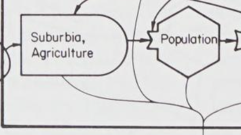

Status: **WIP** (0.9 / 0.45 / 1.35 pt) · [x] Approve · Your call:

### C13 — The ground
Heat pathways meet at a point, one line continues, and it ends in a large **filled**
arrowhead that touches the top of three bars, each shorter than the one above.

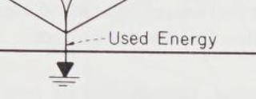

Status: **Wrong**. The package draws an arrowhead, then a gap, then a ground
glyph with its own short stub above the bars, so the line seems to end twice.
Odum's single, larger arrowhead sits directly on the top bar. ·
[x] Approve · Your call:

---

## B. Dissipation

### C02 — Heat sinks converge, and one line leaves the system
Every dissipating component sends a thin pathway down from its underside. They
merge like a river delta at one point **inside** the frame, and a single line
crosses the frame to the ground below.

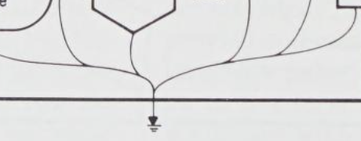

Status: **OK** (fixed in PR #7) · [x] Approve · Your call:

### C03 — Heat taken off a pathway
On a storage's outflow, Odum draws dissipation as a branch off the *pathway*,
marked by a small arrowhead at the junction, not as a line from the symbol's
underside.

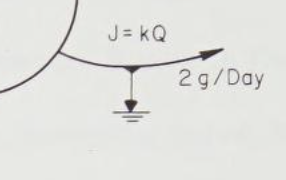

Status: **Partial**. The source-store example draws it by hand; the package
cannot express it. **Decision:** support a `heat` branch on an edge, or keep
drawing these by hand. · [x] Approve · Your call:

### C12 — Interactions dissipate
The symbol sheet draws the interaction with a heat sink, and `strong-source.png`
runs used energy down from the work-transformation interaction. The package
currently says interactions carry no heat sink (AGENTS.md §6), which contradicts
the sheet.

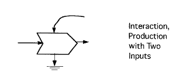

Status: **Wrong** · [x] Approve · Your call:

### C14 — The miscellaneous box dissipates
The sheet's miscellaneous box has a heat sink. The package's `box` is a plain
rectangle with no heat-sink anchor.

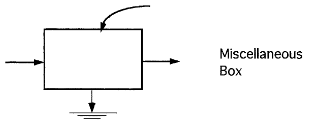

Status: **Wrong**. **Decision:** split it into an Odum `box` symbol (with a heat
sink) and a plain annotation frame, or keep `box` as annotation only. ·
[x] Approve · Your call:

### C16 — Sources and exchanges do not dissipate
Neither the source nor the exchange has a heat sink on the sheet.

Status: **WIP** for exchanges (before `be1a514` a standalone transaction got a
heat line, which is the "Market" fault in the user guide); **OK** for sources. ·
[x] Approve · Your call:

---

## C. Sources and inputs

### C04 — The unused-energy loop
Where a renewable source's pathway crosses the frame, part of it hooks back out:
a branch curls round and leaves with an arrowhead, outside the frame, back
towards the source side. It shows energy that reaches the system and is not
used.

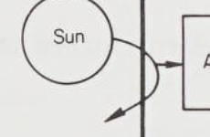 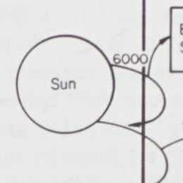

Status: **Missing**. The worked example fakes it with an arrow into an empty
text node, which is the stray Sun arrow. Proposed: an edge key `unused` (both
front ends) drawing the hook where the pathway crosses the frame, or about a third
of the way along if there is no frame. · [x] Approve · Your call:

### C07 — Sources sit around the outside, in order of transformity
Sources sit outside the frame. The lowest-transformity one is on the left, they
run over the top, and the highest is on the right. Inputs from the right flow
leftwards into the system ("Other Nations" → Defense).

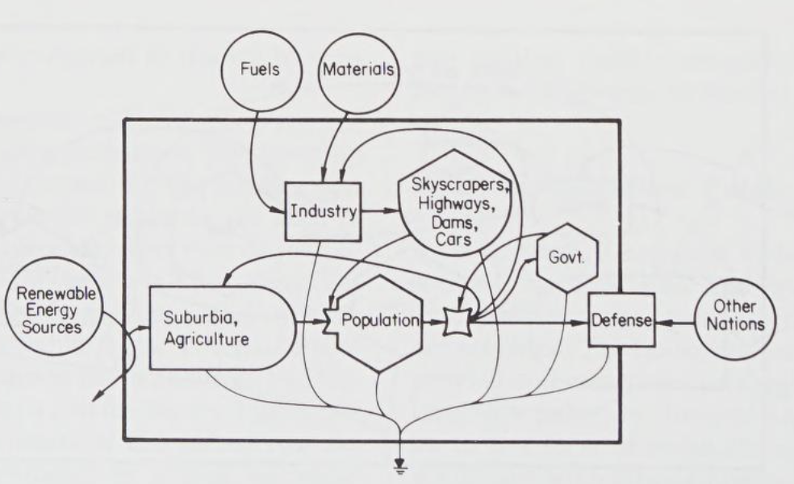

Status: **Partial**. Sources go in the left column or are lifted above the chain;
none are placed on the right or along the top in order. **Decision:** adopt the
perimeter rule for automatic layout. · [x] Approve · Your call:

---

## D. Symbols and how pathways meet them

### C06 — A consumer with an interaction is drawn notched
When a consumer's inflows combine, Odum draws the interaction as a notch in the
consumer's own left vertex (Population, Industry, Consumer), not as a separate
symbol beside it.

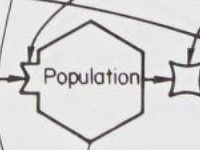

Status: **Missing**. The package draws a separate interaction symbol attached
upstream of the consumer. **Decision:** add a notched-consumer form (for example
`notched=true`, or automatic when an interaction is attached to a consumer). ·
[x] Approve · Your call:

### C15 — Where inputs enter
Main energy comes in on the left and leaves on the right. Second inputs and
controls come in from above: onto the upper slopes of a consumer, the top of an
interaction, the top of a producer or box.

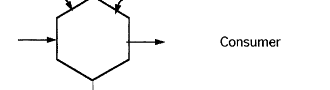

Status: **Partial**. Ports and anchors exist; that second inputs come from above
is not enforced. · [x] Approve · Your call:

### C08 — Feedback loops back over the top
A flow from a higher-transformity component back to a lower one (control,
services) leaves its right or top, arcs **over**, and comes down into the
receiver's top.

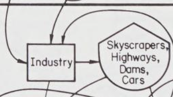

Status: **Partial**. Money feedback arcs over the top. Energy and information
feedback do not, and an energy pathway that falls in transformity is reported
as an energetics violation. **Decision:** add a `feedback` pathway type, or
route any backward pathway this way. · [x] Approve · Your call:

### C17 — Arrowheads
Every pathway ends in a blunt, filled arrowhead touching the receiving symbol's
outline. Heat pathways have no arrowheads until the single one at the ground.

Status: **OK** · [x] Approve · Your call:

---

## E. Exchanges and money

### C05 — An exchange is two opposed tracks through one small diamond
Goods run solid one way, money runs dashed the other. They are paired, roughly
one pen-width apart, and both pass through a small diamond. "$" sits on the
money side.

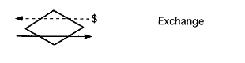 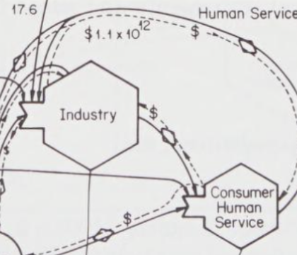

Status: **WIP**. Before `be1a514`, money left from the symbol's upper half on its
own arc. A transaction used as an end point, like "Market" in the guide, is not
an exchange and should not be in the examples at all. · [x] Approve · Your call:

---

## F. Labels and annotation

### C09 — Pathway name above, quantity below
A pathway carries its name on one side (J₀) and its quantity on the other
(2 g/Day).

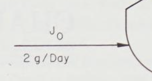

Status: **Partial**. One label per pathway. Proposed: `label` plus an optional
`quantity` on the opposite side. · [x] Approve · Your call:

### C10 — The frame caption goes below the frame, bottom-left
The frame's units caption ("10¹⁵ Calories per Year") sits outside, under the
bottom-left corner. The heat-sink total goes beside the ground.

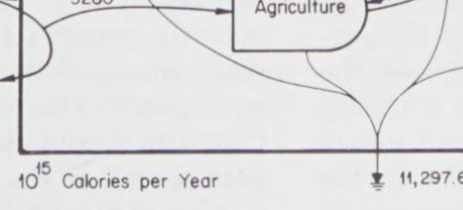

Status: **Wrong**. The package puts the caption inside, top-left. ·
[x] Approve · Your call:

### C11 — Dashed leader lines for annotation
A note naming a part of the diagram is joined to it by a thin dashed leader with
a small arrowhead ("Feedback of Transformed Energy", "Pharaoh", "Used Energy").

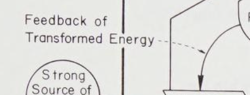

Status: **Missing**. Proposed: `text` nodes take a `points_to` key that draws
the leader. · [x] Approve · Your call:

### C18 — Text inside symbols
Labels are centred inside the symbol and may run to several lines; a storage
may carry its name and its value.

Status: **OK** · [x] Approve · Your call:

---

## G. Layout

### C20 — Components inside the frame run left to right by transformity
Status: **OK** · [x] Approve · Your call:

### C21 — Odum's composition is hand-made
Odum's figures are composed by hand, and automatic layout will not reproduce
them. **Proposed:** each worked example is a *traced* model, with node positions
and waypoints measured from its reference figure using the overlay, so its
placement is right by construction. Automatic layout is judged on its own
fixtures and is not expected to recreate Odum's figures. · [x] Approve ·
Your call:

---

## Out of scope (stated so nobody expects them)

- **Odum's lettering.** His figures use stencil lettering; the package uses TeX
  Gyre Heros Condensed on purpose.
- **Glyphs not on the canonical sheet**, such as the sensor and valve in
  `crop-harvest.png`.
- **Absolute line widths, curve control points and stroke joins.** These cannot
  be recovered from 144 DPI captures (AGENTS.md §2); only ratios within one
  figure can (C01).

## After approval

1. One small test drawing per approved item, shown beside its crop above, with a
   golden image.
2. The examples rebuilt to the list: `simple_system` re-modelled with a real
   exchange; `aggregated-economy` traced from its reference (C21) with the unused
   loops (C04).
3. The user guide revised against the list, with one figure per section beside
   the reference crop it claims to follow.
